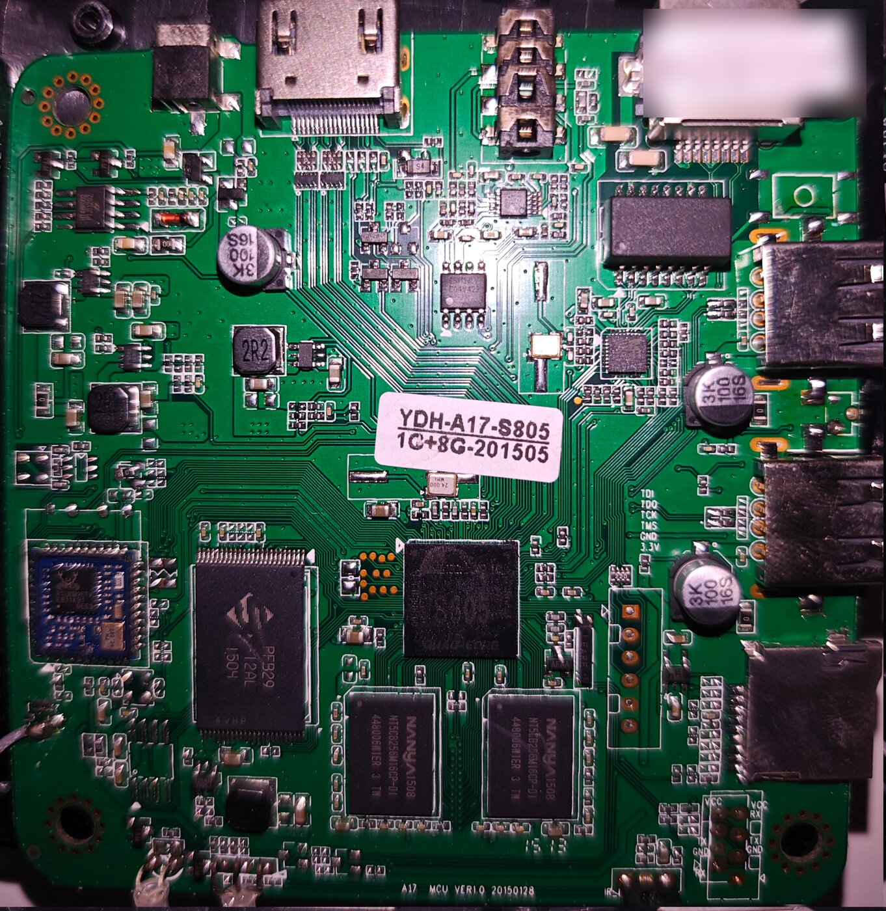

# Armbian (Debian 13, mainline kernel) on an Amlogic S805 TV box

Turns a cheap Amlogic **S805** Android TV box into a small Debian server: official **Armbian trixie, kernel 6.12**, booting from an SD card.

- Nothing is flashed to the box: the **stock u-boot stays** and **Android stays** on the internal NAND.
- Remove the SD card and the box boots Android as before.
- The only permanent change is the boot order (SD/USB first, then Android).

> [!NOTE]
> **Made with AI.** The research, scripts and docs in this repo were written with Claude Code (an AI assistant). I did the hardware side and tested everything on **one box**. It works for me; it may not for you.
>
> **Bug reports welcome, support limited.** If something doesn't work on your box, please [open an issue](https://github.com/tbcp/armbian-s805-tvbox/issues): it may be broken on mine too. I can't promise fixes or take feature requests. Forks are welcome.



## Tested hardware

A-sure "XSR" box, board `YDH-A17-S805 1G+8G`: S805 (4× Cortex-A5, 1.5 GHz), 1 GB RAM, 8 GB NAND, 100 Mbit Ethernet, Realtek RTL8189ETV Wi-Fi. It's a clone of Amlogic's **M201** reference design, like most MXQ-style S805 boxes, so those will probably work too. [More about the hardware](docs/hardware.md).

| | |
|---|---|
| Boots from SD with the stock u-boot | ✅ |
| CPU | ✅ 4 cores, fixed at 1.536 GHz |
| RAM | ✅ 983 MB usable |
| Ethernet | ✅ 100 Mbit |
| HDMI console, USB | ✅ |
| SD card speed | ✅ about 12 MB/s read, 11 MB/s write (hardware limit of the slot) |
| Kernel updates via `apt` | ✅ |
| Internal NAND | ❌ no mainline driver, the OS lives on the SD card |
| Wi-Fi | ✅ RTL8189ETV, 2.4 GHz only ([details](docs/fixes.md#wi-fi-rtl8189etv)) |

Good for Pi-hole and small Docker containers. Geekbench 5 (32-bit): 74 single-core, 142 multi-core, between a Raspberry Pi 2 and 3.

## Quick start

### 1. Build the image (on a Linux PC, no root needed)

```sh
git clone https://github.com/tbcp/armbian-s805-tvbox && cd armbian-s805-tvbox
./build-image.sh armbian-s805.img
```

Needs `curl xz fdisk mkimage mtools debugfs python3` (packages on Debian/Ubuntu: `u-boot-tools mtools e2fsprogs`; on Arch: `uboot-tools mtools e2fsprogs`).

The script downloads the official Armbian image, checks its checksum, and adds the boot files and fixes this box needs ([details](docs/how-it-works.md#what-build-imagesh-changes)). Optional: `MAC=aa:bb:cc:dd:ee:ff ./build-image.sh` to give the box a specific MAC address (for example its original one, so it keeps its DHCP lease), and `BOX_HOSTNAME=name` for a hostname other than `s805box`.

### 2. Write it to an SD card

```sh
sudo dd if=armbian-s805.img of=/dev/sdX bs=4M conv=fsync status=progress
```

### 3. One time only: change the boot order

The box has to run `aml_autoscript` from the card once, in Amlogic **update mode**. With the SD card inserted, do one of:

- **Reset button** (often hidden inside the AV jack): hold it with a toothpick while plugging in the power, release after a few seconds.
- **No button** (like this box): in Android, install a terminal app ([Terminal Emulator](https://f-droid.org/archive/jackpal.androidterm_72.apk), enable *Unknown sources*), then type:
  ```
  su
  reboot update
  ```
  (Try without `su` if your firmware has no root.)
- **"Update & Backup" app** (some firmwares): select `aml_autoscript.zip` from the card.

The box reboots, runs the script, resets, and boots Armbian. From now on it boots the card whenever one is inserted.

### 4. Log in

Find the box's IP address in your router (it shows up as `s805box`), then `ssh root@<box-ip>`, password `1234`. Armbian asks you to set a new root password and create a user. Or use HDMI and a USB keyboard.

**The first 10 minutes or so the SD card is busy in the background** (ext4 zeroing the inode tables of the freshly grown filesystem). That's normal, and it happens only once.

That's it. All fixes are already in the image; nothing to run afterwards. To use Wi-Fi instead of (or besides) Ethernet: `armbian-config` → Network.

## Troubleshooting

| Problem | Fix |
|---|---|
| Boots Android instead | The boot order wasn't changed: repeat step 3 with the card inserted. |
| Stuck at "Waiting for root device" (HDMI) | The faster SD controller doesn't work on your board. Put the card in a PC and delete `dtb/meson8b-xsr.dtb` from the boot partition. The box then boots with the stock device tree (slower SD). |
| Can't find the box on the network | It gets a new MAC address on first boot, so look for a new device called `s805box` in your router's client list. Or connect HDMI and a keyboard and run `ip a`. |
| Random freezes of several seconds | Check `cat /sys/devices/system/cpu/cpufreq/policy0/scaling_governor` says `performance`. See [fixes](docs/fixes.md#freezes-cpu-frequency). |

**Undo everything:** remove the SD card and the box boots Android. (The changed boot order stays, but without a card it behaves like stock.)

## More

- [How it works](docs/how-it-works.md): the stock boot chain, the two boot scripts, what the build script changes
- [Fixes in the image](docs/fixes.md): freezes, SD controller, stable MAC, the ext4 lazyinit bug
- [Hardware](docs/hardware.md): board details, serial header, how the device tree was chosen

## Credits

- [balbes150](https://forum.armbian.com/topic/3023-armbian-for-amlogic-s805-and-s802s812/): the `aml_autoscript` / `s805_autoscript` boot method for S805 boxes
- [Armbian](https://github.com/armbian/community/releases): the Onecloud community image used as the base
- [hzyitc/armbian-onecloud](https://github.com/hzyitc/armbian-onecloud): meson8b mainline work, upstreamed into Armbian
- Mainline [`meson8b-mxq.dts`](https://github.com/torvalds/linux/blob/v6.12/arch/arm/boot/dts/amlogic/meson8b-mxq.dts): the device tree that fits this board

License: [MIT](LICENSE)
