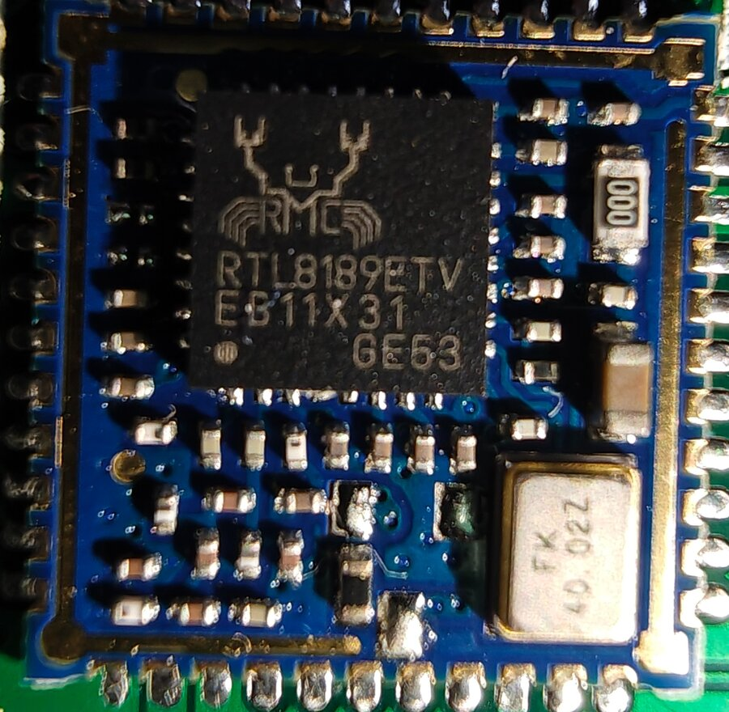

# Fixes in the image

Nothing to do here: `build-image.sh` puts all of these into the image automatically, and the box applies them when it boots. This page explains what each fix does and how to check that it's working.

## Freezes: CPU frequency

**Symptom:** with Armbian's default settings the box randomly freezes for several seconds. SSH hangs, pings take 8–10 s. `dmesg` shows an RCU stall:

```
rcu: INFO: rcu_sched detected stalls on CPUs/tasks:  (t=2105 jiffies ≈ 8 s)
Workqueue: events dbs_work_handler
 clk_core_set_parent_nolock → __clk_notify → twd_rate_change
 → on_each_cpu_cond_mask → smp_call_function_many_cond → gic_ipi_send_mask
```

**Cause:** Armbian's default `ondemand` governor changes the CPU speed constantly (about 1800 times in 2 hours here). On meson8b, every CPU clock change also changes the rate of the per-core ARM TWD timer. `twd_rate_change` then waits for all 4 cores to acknowledge, and that wait can hang for seconds.

**Fix:** never change the frequency. `/etc/default/cpufrequtils`:

```
GOVERNOR=performance
MIN_SPEED=1536000
MAX_SPEED=1536000
```

Armbian applies it at every boot (`armbian-hardware-optimize.service`). Check: `cat /sys/devices/system/cpu/cpufreq/policy0/scaling_governor` shows `performance`, and `…/policy0/stats/total_trans` doesn't increase. Cost: the CPU always runs at full clock, about 45–50 °C at idle (no heatsink). Don't use `schedutil` or `conservative` either.

## Faster SD card: the sdhc controller

The S805 has two SD/MMC controllers. The stock `meson8b-mxq.dtb` drives the SD slot with the older one:

| | `sdio` (stock DTB) | `sdhc` (`meson8b-xsr.dtb`) |
|---|---|---|
| Driver | `meson-mx-sdio` | `meson-mx-sdhc` |
| Bus clock (50 MHz requested) | 39.8 MHz | 47.2 MHz |
| Read, 4 MB direct | 6.8 MB/s | **12.4 MB/s** |
| Write, 500 MB buffered + fsync | – | **10.8 MB/s** |

Measured with a card that does 93 / 38 MB/s in a PC reader. Both drivers handle only one 128 KB segment per request, and the slot only does 3.3 V high speed (50 MHz), so that's the ceiling. For more speed, put the root filesystem on a USB drive instead.

Both controllers can drive the SD pins: mainline's pinctrl has the `sdxc_b` group on `CARD_0`–`CARD_4`, and the box's Android device tree defines the same pins for `sdhc`. The stock DTB has no `__symbols__`, so a normal overlay can't be applied. [`xsr-dtb-build`](../rootfs/usr/local/sbin/xsr-dtb-build) decompiles `meson8b-mxq.dtb` and:

1. disables `mmc@8c20` (`sdio`), keeping its card-detect GPIO and supply,
2. adds an `sdxc-b` pin group,
3. enables `mmc@8e00` (`sdhc`): 4-bit, 50 MHz, high speed, same card detect and supply,
4. writes `/boot/dtb/meson8b-xsr.dtb`.

`build-image.sh` copies a prebuilt copy (`boot/meson8b-xsr.dtb`, built from the image's own `meson8b-mxq.dtb`, which the script checks by checksum). On the box, the APT hook reruns `xsr-dtb-build` after every `dpkg` run. If the build ever fails, it **deletes** `meson8b-xsr.dtb`, and the box boots with the stock DTB on the slower controller instead of a stale one.

Check: `dmesg | grep mmc0` should mention `c1108e00.mmc`. **If it doesn't work on your board**, the kernel waits forever at "Waiting for root device": delete `dtb/meson8b-xsr.dtb` from the card's boot partition on a PC.

## Wi-Fi (RTL8189ETV)

The Wi-Fi module is a **Realtek RTL8189ETV** (SDIO, 802.11n 1×1, **2.4 GHz only**). Android loaded `/system/lib/8189es.ko` for it. Mainline has no driver for it, but Armbian's kernel ships the out-of-tree `8189es` module, so all that's missing is a device tree description. The stock MXQ device tree has none.

Moving the SD card to `sdhc` frees the `sdio` controller, and the Wi-Fi sits on its **port A**. From the box's Android device tree:

| | |
|---|---|
| SDIO bus | `sdio` controller, port A: `GPIOX_0`–`3` (data), `GPIOX_8` (clk), `GPIOX_9` (cmd) |
| Power | `GPIOAO_6` and `GPIOX_11` |
| 32 kHz clock | `GPIOX_10` (`xtal_32k_out`) |
| Max clock | 30 MHz (as in Android) |

`xsr-dtb-build` replaces the `sdio` controller's SD slot (`slot@1`) with a Wi-Fi slot (`slot@0`, non-removable). The slot has to be *replaced*, not just disabled, because the mainline driver only registers the first slot node it finds. The build script then adds the `sd_a` and `xtal_32k_out` pin groups and an `mmc-pwrseq-simple` node that switches on both power GPIOs. If anything about this doesn't match, the script builds the DTB without Wi-Fi, keeping the faster SD card.

Check: `cat /sys/bus/mmc/devices/mmc1:0001/device` shows `0x8179`, `lsmod | grep 8189es`, and `iw dev wlan0 scan` lists networks. The driver also creates a second interface, `wlan1` (for Wi-Fi Direct); ignore it. Set up a connection with `armbian-config` → Network.



## Stable MAC address

On mainline, the Ethernet driver makes up a **random MAC on every boot**, so the DHCP address keeps changing. Armbian's first boot writes a fixed MAC into `/etc/netplan/20-eth-fixed-mac.yaml`, but that never takes effect: netplan puts it into a second `.network` file, and systemd-networkd only uses the first matching one (Armbian's `10-netplan-all-eth-interfaces.network`).

A systemd **`.link`** file works. On first boot, `s805-pin-mac.service` runs before networking starts, generates a random locally administered MAC (`02:…`), writes `/etc/systemd/network/10-eth0-mac.link`, and applies it, so even the first DHCP request uses it. On later boots the service is skipped because the file exists.

To use the box's original MAC (same DHCP lease as Android): build with `MAC=aa:bb:cc:dd:ee:ff ./build-image.sh`, or edit `MACAddress=` in that file and reboot. The original MAC is usually on the box's sticker, or in Android's kernel command line (`mac=…`). Don't use u-boot's `ethaddr`: `00:15:18:01:81:31` is Amlogic's generic default, shared by many boxes.

## ext4lazyinit stuck at 100% CPU

**Symptom:** hours after first boot, the kernel thread `ext4lazyinit` still uses 100% of one core while the SD card is idle.

**Background:** when Armbian grows the root filesystem on first boot, ext4 zeroes the new inode tables later, in the background, one block group at a time, with a pause between groups.

**The bug:** kernel 6.12 measures how long the first group takes with the **wall clock** and sets the pause to 10× that. If the system clock jumps during that measurement, the next run gets scheduled absurdly far in the future, and a second bug in the same loop makes the thread busy-wait instead of sleeping, forever. This box has no RTC, so the clock jumps at every boot: from 1970 to the saved time, then again when NTP syncs. Fixed upstream in Linux 6.13 ([`e06a8c24f644`](https://git.kernel.org/torvalds/c/e06a8c24f644)), not backported to 6.12.

**Fix:** `s805_autoscript` boots with `rootflags=init_itable=0`, which sets the pause to 0, so the bad measurement doesn't matter. The zeroing then runs flat out once, for about 10 minutes after first boot. Check: `findmnt -no OPTIONS /` includes `init_itable=0`.

If you boot without that option and the thread is stuck, this unsticks it without a reboot:

```sh
mount -o remount,noinit_itable /    # drop the stuck job
mount -o remount,init_itable=0 /    # start a fresh one without the pause
```
