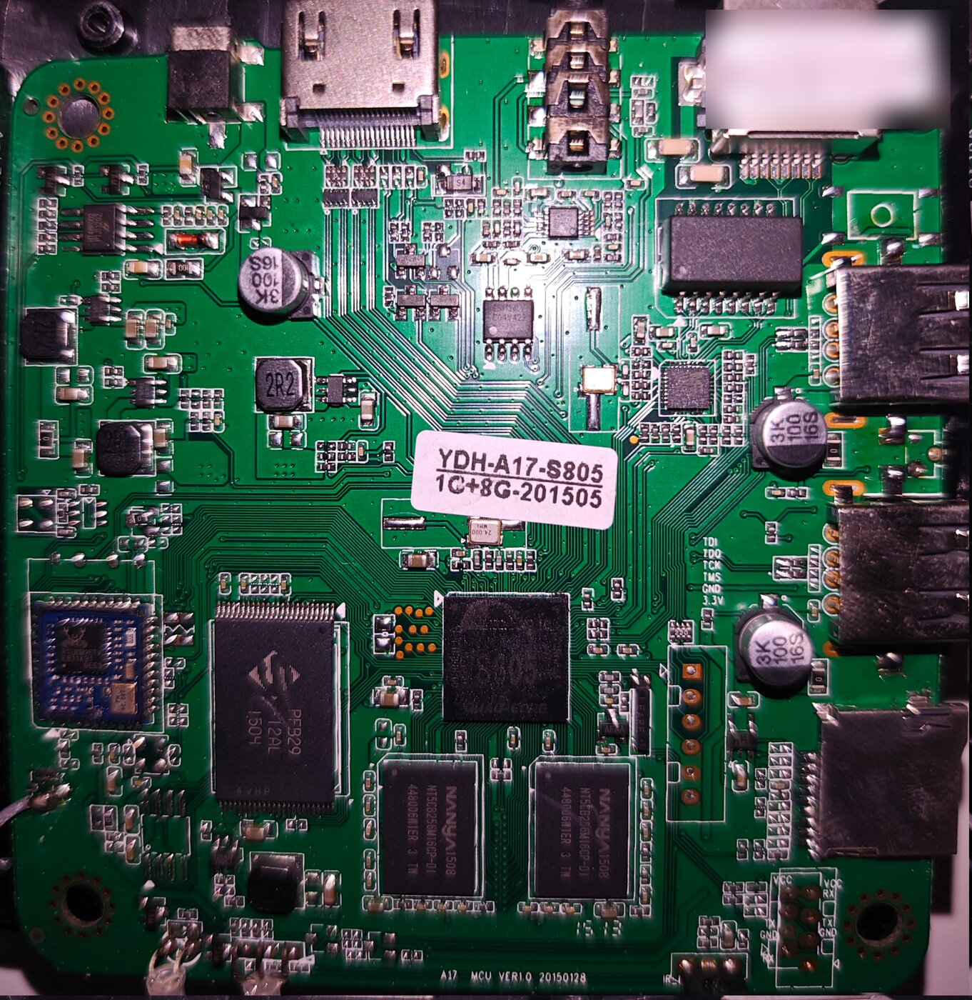
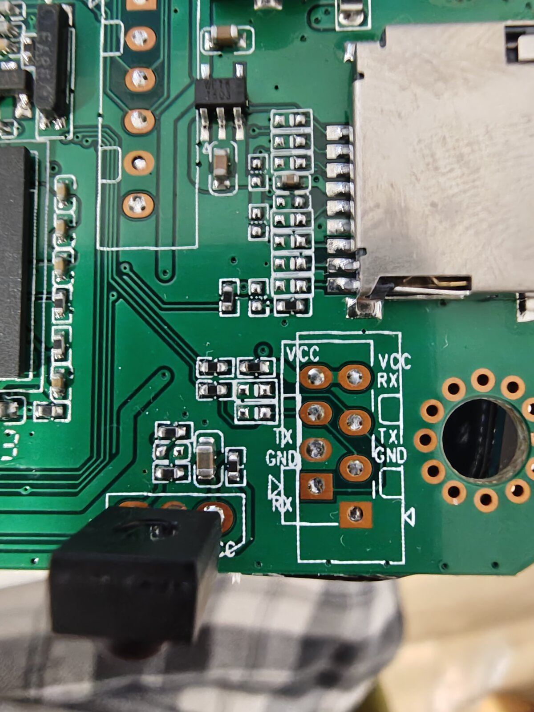

# Hardware

| | |
|---|---|
| Box | A-sure smart TV box, model **XSR** |
| Board sticker | `YDH-A17-S805 1G+8G-201505` |
| PCB silkscreen | `A17 MCU VER1.0 20150128` |
| SoC | Amlogic **S805** (meson8b), 4× Cortex-A5 @ 1.536 GHz, Mali-450 |
| RAM | 1 GB DDR3 (2× Nanya NT5CB256M16CP) |
| Storage | 8 GB **raw NAND** (TSOP-48), not eMMC |
| Ethernet | 100 Mbit, **IC Plus IP101A/G** PHY (`0x02430c54`), RMII |
| Wi-Fi | **Realtek RTL8189ETV** SDIO module, 2.4 GHz ([works](fixes.md#wi-fi-rtl8189etv)) |
| Android | 4.4.2, kernel 3.10, Amlogic device tree id **`m8b_m201_1G`** |
| RTC | none (the clock is set by NTP at boot) |
| Reset / recovery button | **none** |
| Serial | 2×4 staggered header near the SD slot (not needed) |

## Serial header

Two overlapping label sets: check with a multimeter before connecting, and **never connect VCC**. 115200 8N1; mainline calls the port `ttyAML0`.

## How the device tree was chosen

There's no public device tree or documentation for "YDH-A17". What made it workable:

- Android's own device tree (dumped from `/proc/device-tree` under an old 3.10 kernel, see [`reference/android-devicetree-m8b_m201_1G.dts`](../reference/android-devicetree-m8b_m201_1G.dts)) has the id `m8b_m201_1G`: a clone of Amlogic's **M201 reference design**, which most MXQ S805 boxes are built on.
- The Android Ethernet driver logs PHY ID `0x02430c54`, an **IC Plus IP101A/G**. Mainline's [`meson8b-mxq.dts`](https://github.com/torvalds/linux/blob/v6.12/arch/arm/boot/dts/amlogic/meson8b-mxq.dts) (TRONFY MXQ S805) describes exactly that PHY at the same address, plus an SD slot.

So `meson8b-mxq.dtb` was the first choice, and it worked unmodified (4 cores, 983 MB, Ethernet, HDMI). The changes made later: the SD slot moved to the faster controller ([details](fixes.md#faster-sd-card-the-sdhc-controller)), the Wi-Fi enabled, and the model name changed from "TRONFY MXQ S805" to "Amlogic S805 TV Box" (shown by tools like fastfetch; the Geekbench result above predates that).

## Internal NAND

The NAND is raw NAND behind Amlogic's proprietary NFTL layer. Mainline has no driver for it on meson8b, so the OS has to live on SD or USB, and Android on the NAND stays untouched. The u-boot environment ([after the boot-order change](../reference/uboot-env-after-aml_autoscript.txt)) is the only thing written to it.
